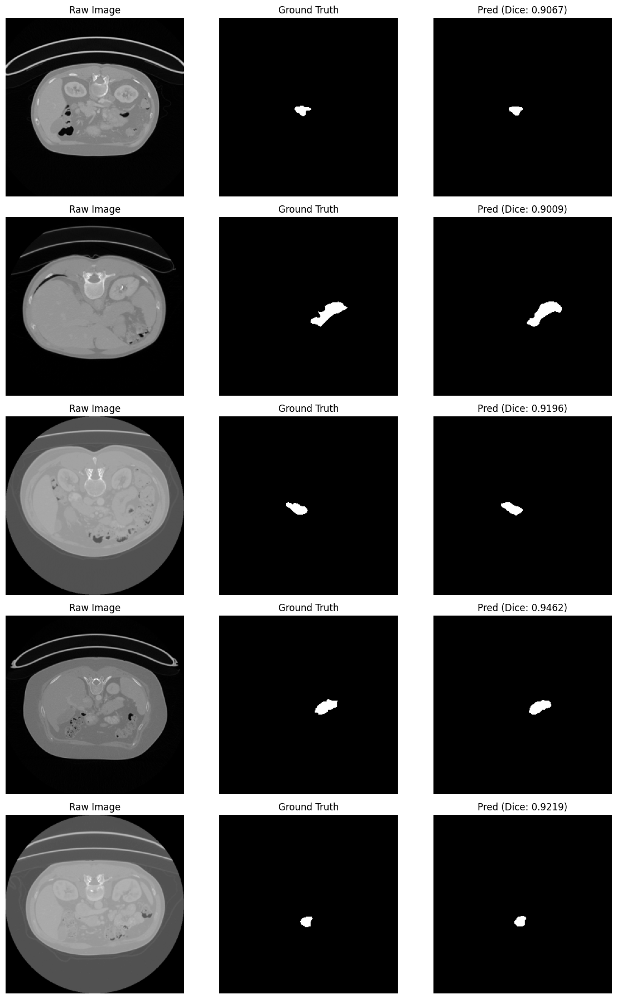

# Hi there, I'm Rahmatilla Xudoyberdiyev 👋
### AI Systems & Agentic Workflows Engineer

📍 **Tashkent, Uzbekistan** | 💼 **Available for new projects**  
🌐 [rahmatilla.uz](https://www.rahmatilla.uz) • 💬 [Telegram](https://t.me/rahmatilla_uz) • 💼 [LinkedIn](https://www.linkedin.com/in/rahmatilla-xudoyberdiyev) • ✉️ [Email](mailto:xudoyberdiyevrahmatilla@gmail.com) • 📄 [Resume / CV](https://www.rahmatilla.uz/resume.pdf)

---

### 🚀 About Me

I engineer production AI systems and agentic workflows, focusing on autonomous pipelines, multi-agent orchestration, and retrieval-augmented generation (RAG). My technical foundation combines practical LLM orchestration—built natively or via frameworks like LangChain—with machine learning using TensorFlow and computer vision with OpenCV.

To bring these systems into production, I develop dependable backend services and web applications using Django, Flask, PostgreSQL, and Next.js, along with asynchronous event-driven tools like Aiogram. I prioritize clean architecture, high reliability, and shipping maintainable software that solves real operational bottlenecks.

---

### 🌟 Featured Projects

#### 🤖 [Emris AI](https://suniyintellekt.uz) — Agentic AI Workflow `v1.9 BETA • Active`
* Engineered an autonomous multi-agent AI platform that breaks down complex user prompts into step-by-step milestones, writes code, and automatically reviews and fixes its own bugs before delivery.
* Built an interactive in-browser code execution sandbox (Python & Node.js) with fault-tolerant routing across Google Gemini, Groq, and Cloudflare AI to ensure fast, uninterrupted performance.
* Designed a privacy-first, local-storage architecture that syncs generated projects directly to the user's device without requiring accounts or storing sensitive data on external servers.

        

#### 🤖 [Samarqand Invest Kompaniyasi](https://www.saminvestcompany.uz/uz) — Website `Active`

 

#### 🤖 [Pancrease Segmentation](https://www.kaggle.com/code/rahmatillauz/pancrease-segmentation) — Image Segmentation `Active`

  

---

### 🛠️ Tech Stack & Skills

**Agentic AI Workflow**  
       

**Machine Learning & Deep Learning**  
    

**Data Analysis & Web Scraping**  
     

<b>🧩 Additional Skills & Tooling (2 categories)</b>

**Databases & ORM**  
   

**Software Development & Tools**  
       

---

### 💼 Experience

#### 🏢 IT Support Specialist — **Yangi Toshkent Direksiyasi**
_Jun 2026 - Present · Part-time · On-site · Yangi Toshkent, Tashkent, Uzbekistan_  
* Managed server infrastructure and administered Face ID biometric access systems.
* Oversaw IVMS camera security operations and surveillance network maintenance.
* Developed and deployed custom web applications with AI-driven integrations.
`Kerio Control` `Hikvision`

#### 🏢 IT Support Specialist — **Yangihayot tuman hokimiyati**
_Jul 2025 - Jan 2026 · 7 mos · Part-time · On-site · Yangihayot, Tashkent, Uzbekistan_  
* Provided technical support to government employees, troubleshooting software issues and hardware diagnostics.
* Managed network operations and secure traffic routing through Kerio Control firewall systems.
* Overseen FaceID biometric access checkpoints and IVMS camera security infrastructure with Hikvision.
`Kerio Control` `Hikvision` `Network Security` `Hardware Support` `FaceID Systems`

---

### 📜 Verified Credentials & Certifications

* **[Build RAG Applications: Get Started](https://www.coursera.org/account/accomplishments/verify/LDT1J1MXIOXD)** — IBM (Oct 2026)
* **[Develop Generative AI Applications: Get Started](https://www.coursera.org/account/accomplishments/verify/9JLE0OUMAI56)** — IBM (Oct 2026)
* **[Agentic AI](https://coursera.org/verify/0NOCIWLGSQNE)** — DeepLearning.AI (Oct 2026)

<b>📜 More Certifications (3)</b>

* [Sun'iy intellekt – NLP (nutq bilan ishlash)](https://mohirdev.uz/certificate/prac-e2261a41) — Mohirdev (Oct 2023)
* [Introduction to Generative AI](https://www.coursera.org/account/accomplishments/verify/L55EN5Q3M1Y4) — Google Cloud (Feb 2026)
* [IELTS - 7.0](https://www.rahmatilla.uz/api/media/view?pathname=UZ00424504916-22-12-2024-ETRF-1791637462800-cjj9pke-LVrAkIvrXTbF5qUd7Jq1R4MhPqhZax.pdf) — IELTS IDP in Uzbekistan (Dec 2024)

---

### 🎓 Education

#### 🏛️ TIIAME NRU
**Bachelor's degree, Artificial Intelligence** | _Sep 2023 – Jul 2027_  
Focused on advanced topics in computer science including algorithms, big data, data science, machine learning, and neural network foundations.  
`Python (Programming Language)` `Web Development` `Algorithms` `Data Science` `Machine Learning`

#### 🏛️ TUIT Lyceum a.k.a TATU akademik litseyi
**Student, Information Technology** | _Sep 2021 – Jul 2023_  
Studied advanced mathematics and physics alongside programming fundamentals. Gained a strong foundation in problem-solving, algorithmic thinking, and early back-end development practices.  
`Physics` `Mathematics` `Programming Fundamentals` `Algorithms`

---

### 🌐 Languages

**Uzbek**: `Native` • **English**: `C1 (IELTS 7.0)` • **Russian**: `A2`

<b>More Languages (1)</b>

Korean: `A1 (TOPIK 1)`

---

  Let's connect: <a href="https://t.me/rahmatilla_uz">Telegram</a> • <a href="https://www.linkedin.com/in/rahmatilla-xudoyberdiyev">LinkedIn</a> • <a href="https://www.rahmatilla.uz">rahmatilla.uz</a>

